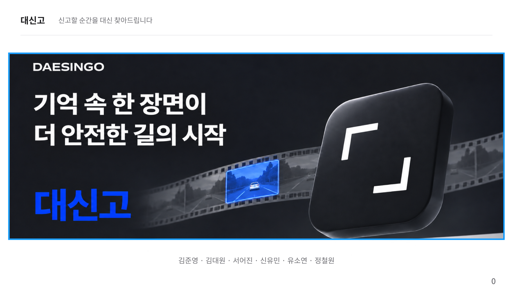
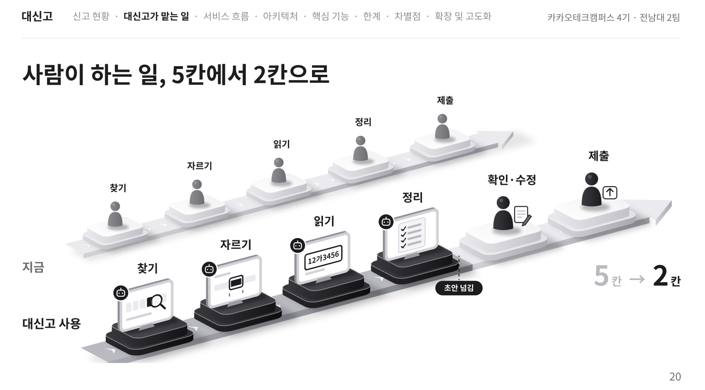
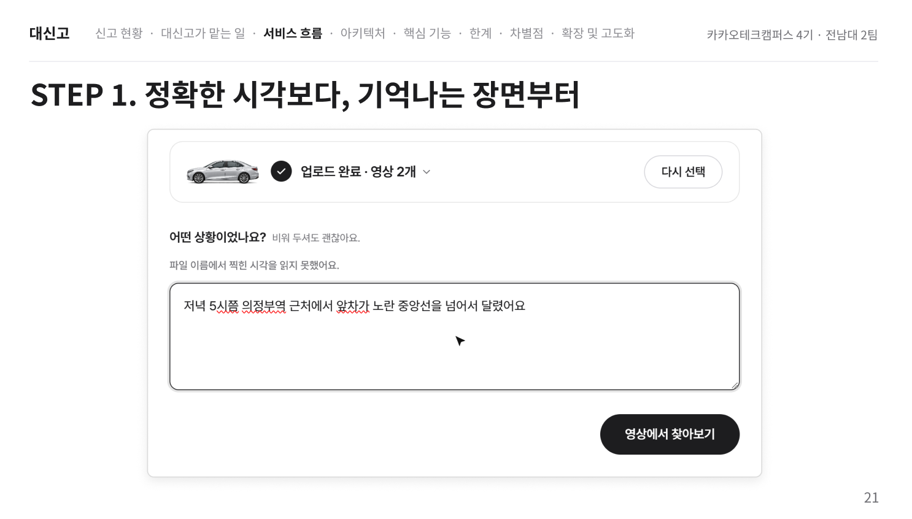
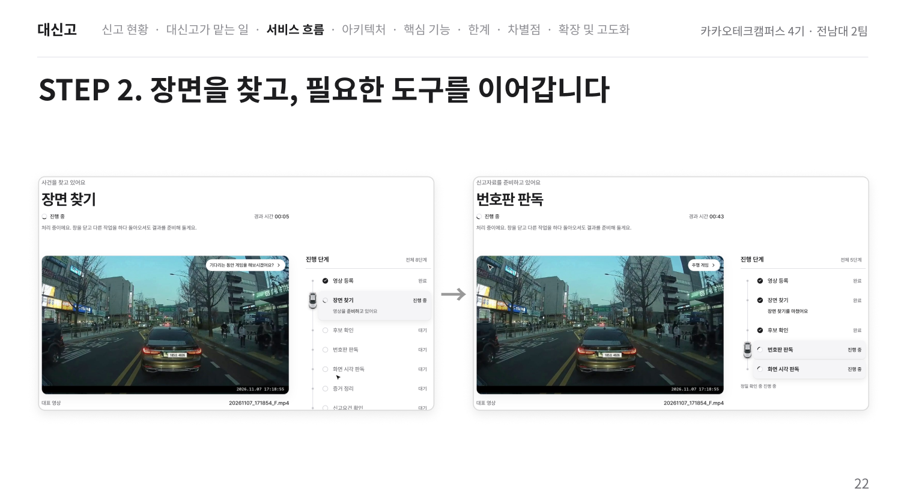
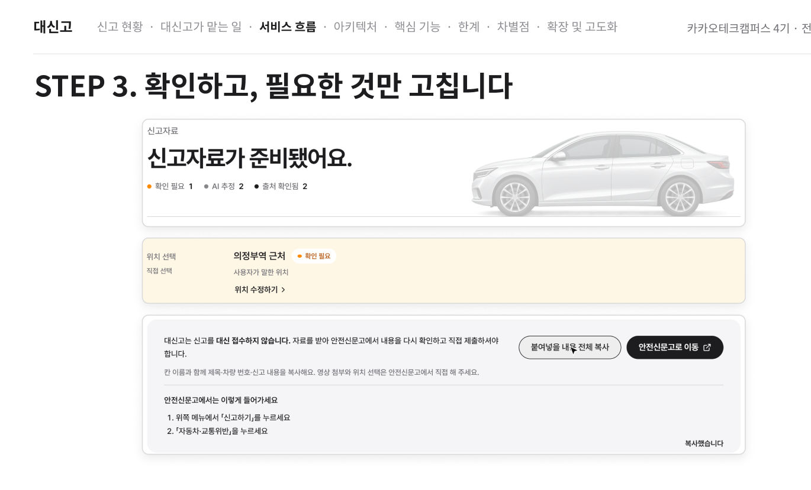
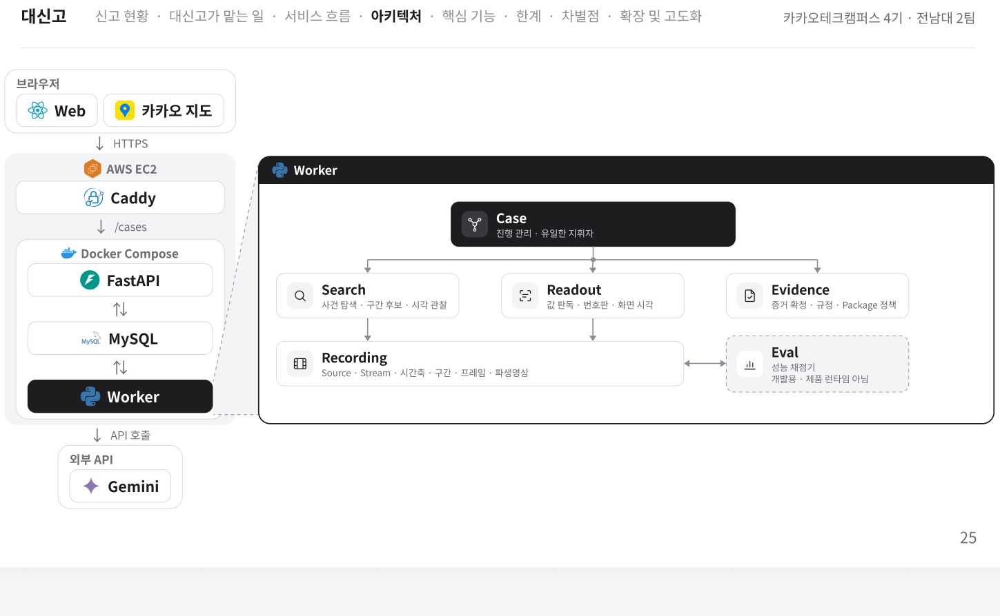
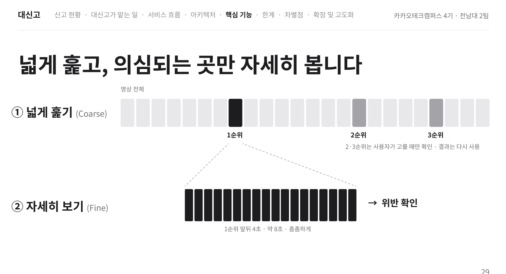
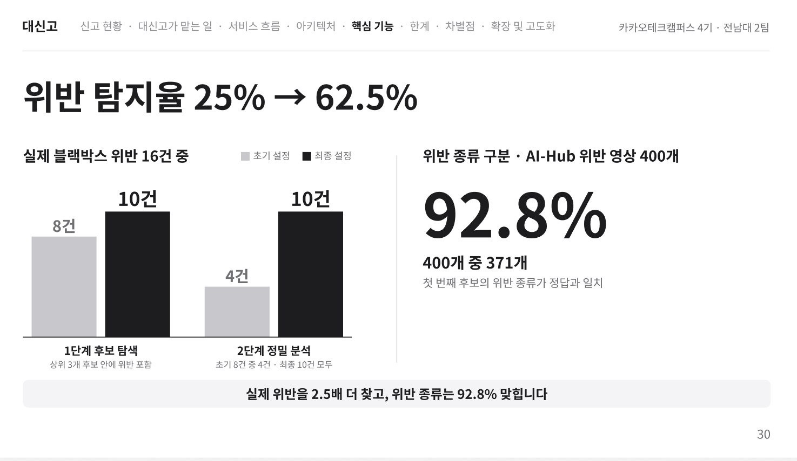
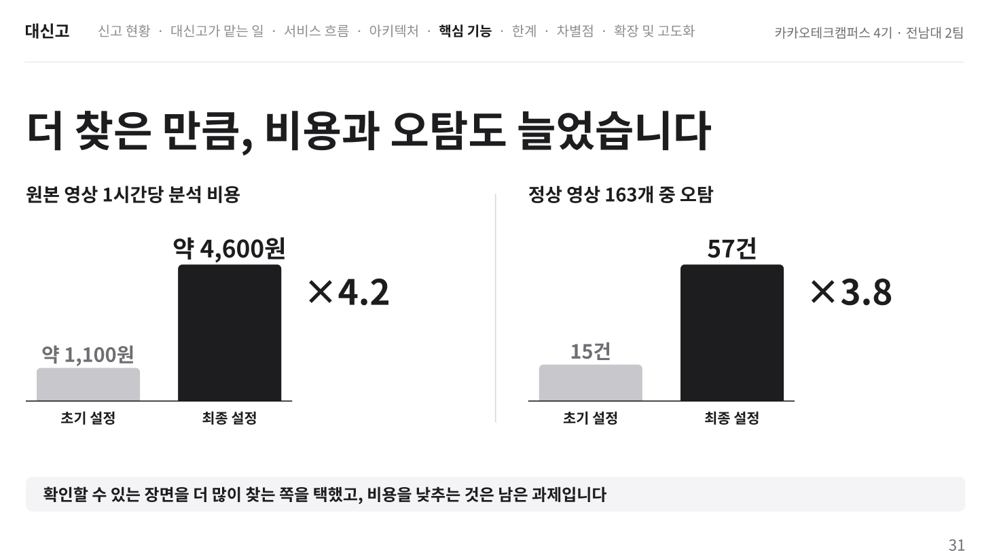

<div align="center">

# 대신고 · Daesingo



**블랙박스 속 장면을 찾고, 신고자료 준비까지.**

[**서비스 체험하기 ↗**](https://daesingo-ktc4.duckdns.org/) · [**주요 기능**](#주요-기능) · [**아키텍처**](#아키텍처) · [**평가 결과**](#평가-결과) · [**개발 환경**](docs/getting-started.md)


</div>

## 서비스 소개

긴 영상을 뒤져 장면을 찾고, 자르고, 번호판을 읽고, 신고 내용을 정리하는 일.
**대신고가 자료의 초안을 준비하면, 사용자는 확인·수정하고 직접 제출합니다.**



지원 유형은 **신호위반 · 중앙선 침범 · 백색 실선 침범 · 이륜차 안전모 미착용**입니다.
AI가 법적 위반 여부를 최종 확정하거나 신고를 자동 제출하지 않습니다.

## 주요 기능

### 01. 기억나는 장면부터

영상을 올리고 기억나는 시간·차량·상황을 적으면 탐색 단서로 정리합니다.



### 02. 장면을 찾고, 필요한 도구를 연결

후보 탐색부터 정밀 확인·번호판 판독·증거 정리까지 진행 상태를 보여줍니다.



### 03. 확인하고, 필요한 것만 수정

불확실한 값은 확인하도록 표시합니다. 내용을 보완하고 영상·이미지를 내려받아 안전신문고에서 직접 제출합니다.



## 공개 체험

**[대신고 열기 ↗](https://daesingo-ktc4.duckdns.org/)** · Desktop Web · 로그인 없이 체험

제공받은 공식 3분·10분 ZIP을 풀고 같은 묶음의 MP4를 올려 주세요. 합계 **10분까지** 이용할 수 있습니다.
공개 체험은 공식 샘플만 받으며, 결과는 시작한 브라우저에서 확인합니다. 체험 시작 24시간 후부터 자동 정리 대상이므로 필요한 자료는 미리 다운로드해 주세요.

[공개 운영 안내](docs/runtime/a1-public-readiness.md#2026-11-10-최종-aws-공개-배포)

## 아키텍처



**API는 요청과 조회, Worker는 영상 분석과 파일 생성**을 담당합니다. 작업은 MySQL 기반 DB Queue로 연결합니다.
그림의 Eval은 개발용 평가 도구이며 **제품 Worker 안에서 실행되지 않습니다.** 카카오 지도는 키가 설정된 경우 사용하는 보조 기능입니다.

<details>
<summary><b>모듈별 역할과 설계 원칙</b></summary>

| 계층 | 구성 | 역할 |
| --- | --- | --- |
| 화면 | React Web | 서버가 제공한 `CaseView`로 진행 상태와 결과 표시 |
| 요청·진행 관리 | FastAPI · `case` | 명령 처리, 사용자 선택, 작업 요청, 부분 재실행 |
| 분석·미디어 처리 | Worker · `search` · `readout` · `recording` | 장면 탐색, OCR, 프레임 추출, 영상 생성 |
| 신고자료 구성 | `evidence` | 관찰 결과와 사용자 확인을 구분하고 신고요건·자료 구성 |
| 저장·실행 기반 | MySQL 8.4 · DB Queue · media volume | 도메인 데이터, 작업 실행 상태, 원본·파생 파일 관리 |
| 오프라인 평가 | `eval` | 예측 저장과 채점 분리, 동일 정답지로 설정 비교 |

### 설계에서 중요하게 본 세 가지

- **관찰과 확정 분리:** AI가 관찰한 결과와 사용자가 확인한 값을 구분해, 불확실한 정보가 확정값으로 바뀌지 않도록 했습니다.
- **수정한 부분부터 다시 실행:** 사용자 보정과 후보 변경을 `case`가 관리하고, 필요한 작업을 다시 요청합니다.
- **제품과 평가 분리:** 제품 모듈은 평가 코드를 참조하지 않습니다. 저장한 예측 결과를 별도 채점기로 평가합니다.

[모듈 경계와 계약](docs/architecture/module-architecture.md) · [Runtime 설계](docs/runtime/runtime-tech-spec.md) · [논리 ERD](docs/architecture/erd-draft.md)

</details>

### 넓게 찾고, 선택한 후보를 자세히



먼저 넓은 범위에서 후보를 찾고, 선택한 후보를 자세히 확인합니다. 다른 후보를 선택하면 해당 장면을 검증하고 이미 얻은 결과는 다시 사용합니다.

## 평가 결과

**2026-11-01 평가 기록** · 실제 사건 탐색과 위반 유형 분류를 각각 평가했습니다.



사건 탐색은 위반 **16건 중 4건 → 10건**, 유형 분류는 AI-Hub 양성 영상 **400개 중 371개**입니다.
설정 선택에 사용한 사건 10건이 포함된 개발 평가이며, 두 수치는 서로 다른 과제의 결과입니다.

<details>
<summary><b>평가 조건·번호판 결과·비용과 오탐 함께 보기</b></summary>



| 평가 대상 | 데이터·조건 | 결과 |
| --- | --- | --- |
| 영상의 위반 유형 찾기 | AI-Hub 양성 영상 400개, 최상위 후보 유형 일치 | **371/400 · 92.8%** |
| 실제 영상에서 사건 찾고 확인하기 | 유튜브 179클립·위반 16건, 상위 3개·시점 ±2초·유형 일치·Fine 확인 | **10/16 · 62.5%**, 정상 클립당 최종 오탐 **0.35건** |
| 번호판의 잘못된 확정 줄이기 | AI-Hub 번호판 crop 314장, O1 → O2 판독 규칙 비교 | **129건 → 32건**, 전체 정답률 **21.0% → 36.0%** |

유형 적중률은 양성 영상의 분류 결과이고, 번호판 수치는 잘라낸 이미지의 인식 결과입니다. 사건 탐색은 표본 16건으로 95% 신뢰구간이 약 39–82%이며, 설정 선택에 사용한 사건 10건이 포함된 개발 평가입니다. 번호판 O2는 10/22 규칙 기준입니다. 각 수치를 전체 제품의 일반화 성능으로 합산하지 않습니다.

[평가 결과와 조건](docs/modules/eval/evaluation-results-2026-11-01.md) · [평가 실행 방법](eval/README.md) · [지표 정의](docs/modules/eval/metrics/metric-definitions.md)

</details>

## 기술 스택

| 영역 | 사용 기술 |
| --- | --- |
| Frontend | React 19 · TypeScript · Vite 6 · CSS · Vitest · Playwright |
| Backend | Python 3.12+ · FastAPI · Pydantic · SQLAlchemy · Alembic |
| AI·영상 | Gemini · PaddleOCR · OpenCV · FFmpeg / FFprobe |
| 데이터·비동기 작업 | MySQL 8.4 · DB Queue |
| 배포·운영 | AWS · Docker Compose · Caddy · GitHub Actions · ECR · SSM |
| 검증 | pytest · Ruff · mypy · 모듈 경계 검사 |

<a id="실행"></a>

## 빠른 시작

Node.js 20 이상에서 저장소 루트에서 실행합니다.

```bash
npm ci
npm run dev:web
```

Vite 주소의 `/?demo`는 API 없는 목데이터 시연입니다. 실제 분석(`/`)은 API·Worker 설정이 필요합니다.
[개발 환경과 실행](docs/getting-started.md) · [웹 앱 안내](apps/web/README.md) · [평가 실행](eval/README.md)

<details>
<summary><b>테스트·저장소 구조·배포 문서</b></summary>

```bash
uv sync --locked --extra test --extra quality
uv run pytest tests/eval -q
npm run test:web
npm run build --workspace=daesingo-web
```

API·Worker·MySQL 구성, OCR 모델, 환경변수, migration과 통합 테스트 실행은 [개발 환경과 실행](docs/getting-started.md)을 따릅니다.

## 저장소 구조

```text
apps/web/           실제 웹 앱
apps/prototype/     목데이터 기반 초기 흐름 프로토타입
src/daesingo/       API · Worker · 도메인 모듈
eval/              데이터 목록 · 예측 · 채점 · 평가 결과
tests/             모듈별 테스트와 CI 실행 도구
docs/              제품 · 아키텍처 · 모듈 · 운영 문서
deploy/            배포와 복구 도구
scripts/           경계 · 품질 · 보안 검사
```

## 배포와 검증

GitHub Actions에서 Python 회귀·MySQL 통합·Runtime 품질 검사와 웹 테스트를 실행합니다. 배포는 OIDC 인증으로 AWS에 연결하고 ECR 이미지와 SSM을 사용합니다.

| 확인할 내용 | 문서 |
| --- | --- |
| API·Worker 실행과 설정 | [API](src/daesingo/api/README.md) · [Worker](src/daesingo/worker/README.md) · [실행환경](docs/runtime/local-runtime-environment.md) |
| 웹 화면·API 연결·테스트 | [Web README](apps/web/README.md) |
| CI 분할과 MySQL 검증 | [CI 실행 구조](docs/runtime/ci-test-partitions.md) |
| 배포·복구·보관 정책 | [공개 배포](docs/runtime/rt14-public-deployment.md) · [운영 명세](docs/runtime/ops-spec.md) |
| 설계·의사결정·모듈별 자료 | [문서 목차](docs/README.md) |

</details>

## 팀

| 이름 | 담당 |
| --- | --- |
| 김준영 | PM · 증거 확정·신고자료 구성(`evidence`) · 공통 기반·운영 |
| 유소연 | 진행 관리·오케스트레이션(`case`) · E2E 통합 |
| 서어진 | 사건 후보 탐색·정밀 검증(`search`) |
| 신유민 | 번호판·화면 값 판독(`readout`) · Web 상태·API 연결 |
| 정철원 | 블랙박스 파일·미디어 처리(`recording`) · 작업 실행 기반 |
| 김대원 | 평가 설계·채점(`eval`) · Web 화면·접근성 구현 |

모듈별 역할과 협업 경계는 [담당 영역](docs/management/ownership.md)에 정리했습니다.

## 라이선스

[MIT](LICENSE)
