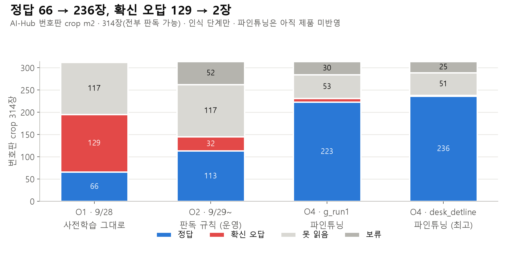
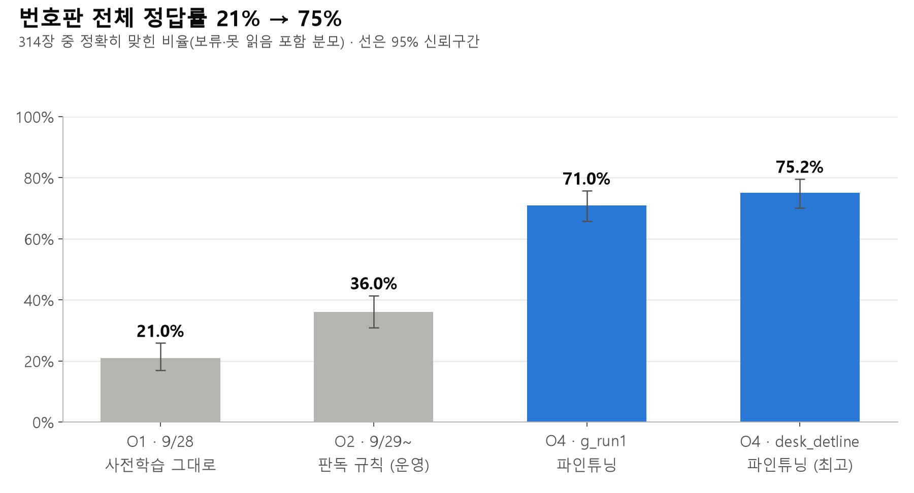
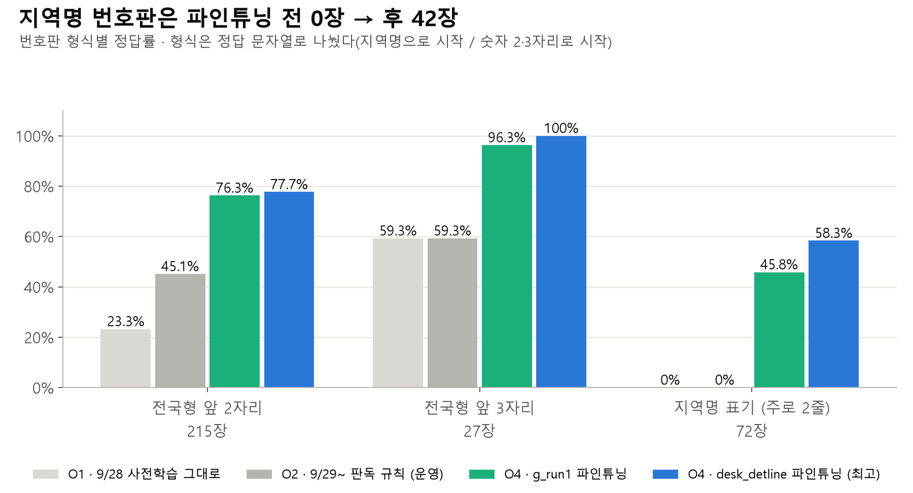

# 2026-10-28 · OCR(번호판 판독) 시점별 평가 — O1 · O2 · O4

작성: 김대원 · 브랜치 `feat/eval-search-points`

번호판 판독이 바뀐 시점을 같은 평가셋(AI-Hub 번호판 crop m2, 314장)에서 비교했다. **개발 중 반복 측정**이다. 잠근 셋은 쓰지 않았다. 번호판 값은 비공개 폴더(`DAESINGO_EVAL_PRIVATE_ROOT`)에만 있고, 이 문서와 차트에는 집계 수치만 옮겼다.

## 한눈에 — m2 314장 (전부 판독 가능)

| 지표 | O1 · 9/28 사전학습 그대로 | O2 · 9/29~ 판독 규칙 (**현재 운영**) | O4 · 파인튜닝 g_run1 | **O4 · 파인튜닝 desk_detline** |
| --- | --- | --- | --- | --- |
| 전체 정답률 (정답 / 314, 95% CI) | 0.210 (0.169–0.259) · 66 | 0.360 (0.309–0.414) · 113 | 0.710 (0.658–0.758) · 223 | **0.752** (0.701–0.796) · 236 |
| 값을 낸 것 중 정답 (`exact_accuracy`) | 0.212 | 0.431 | 0.785 | **0.817** |
| 확신 오답 (틀린 값을 확정) | 129 | 32 | 8 | **2** |
| 못 읽음 (글자를 못 찾음, `UNKNOWN`) | 117 | 117 | 53 | 51 |
| 보류 (`NEEDS_REVIEW`) | 2 | 52 | 30 | 25 |
| 제품 반영 | 과거 | **운영 중** | 미반영 | 미반영 (후보) |

**한 줄:** 판독 규칙(O2)으로 확신 오답을 129장에서 32장으로 줄였고, 파인튜닝(O4)으로 전체 정답률을 21%에서 75%로 올렸다. 다만 파인튜닝은 아직 제품에 들어가지 않았다. 지금 운영 중인 것은 O2 + O3(프레임 7장 다수결)다.

## 발표용 차트

이미지 원본은 `img/`에 있다.







## [CASE]

| 항목 | 값 |
| --- | --- |
| manifest | `private_aihub172_plate_m2` · m2 · GT `ap2` |
| 구성 | AI-Hub 172 번호판 crop 314장, 전부 `READABLE`. m1 500장에서 파인튜닝 valid 라벨에 든 186장을 뺐다(학습 데이터가 평가에 섞이지 않게) |
| 형식 (정답 문자열로 분류) | 전국형 앞 2자리 215 · 전국형 앞 3자리 27 · 지역명 표기 72 |
| 재는 것 | **인식 단계만.** crop이 이미 잘려 있어 차량 검출·번호판 위치 찾기는 빠져 있다 |

**해석 주의:** 판독 불가 번호판이 없어 `wrong_accept_rate`(판독 불가를 확정한 비율)는 잴 수 없다. AI-Hub 데이터는 파인튜닝 학습 데이터와 출처가 같아(split은 다르다) O4에 유리하다. 실제 블랙박스에서의 이득은 더 작다(아래 「블랙박스 참고」).

## [PIPELINE] — 시점과 실행

| 시점 | 무엇이 바뀌었나 | 측정 실행 | 코드 |
| --- | --- | --- | --- |
| O1 | 기준선: PaddleOCR 3.7 · PP-OCRv5 korean 사전학습 그대로 | `ver_R0_m2_20261022` | `3db9b10a` (9/28) |
| O2 | 판독 규칙: 공백 정리, 형식이 온전한 것만 확정, 2줄 번호판이 반만 읽히면 보류 (`ec91a48e` 등) | `ver_R2_m2_20261022` | `e267142d` (10/22, readout 코드는 10/07 이후 변경 없음 = 현재 운영) |
| O3 | 프레임 7장을 읽어 문자열 다수결 (`5edd5a0a`, 10/07) | crop 한 장으로는 잴 수 없다. O2 실행에 코드는 들어 있지만 프레임이 1장이라 항상 `SINGLE_FRAME` | — |
| O4 | 인식기 파인튜닝 (#215, 신유민) — g_run1(노트북 1회차) · desk_detline(데스크톱) | `readout_ft_*_m2_20261023` | `1f830af` + 가중치, 신유민 환경에서 실행 |

- 모두 `readout:paddle-crop` 하네스 경로, 채점 `plate` p2 · 비용 c3. O1·O2는 10/22에 당시 커밋으로 다시 돌린 재현 실행이다.
- O4의 예측은 신유민 님이 같은 314장에 돌린 결과를 받아 우리 채점기로 채점했다. 가중치는 이 PC에 없어 직접 다시 돌리지 않았다.
- **환경 대조군:** 신유민 환경의 사전학습 모델(`readout_ft_pretrained_default`)은 O2와 314장 중 312장이 같은 결과다(정답 111 vs 113). 두 환경의 차이는 O4 효과에 비해 무시할 수준이다.
- API 비용은 없다(로컬 CPU 실행).

## [RESULT]

### 같은 314장에서 바뀐 것 (짝 비교)

| 비교 | 틀림→정답 | 정답→틀림 | McNemar p |
| --- | --- | --- | --- |
| O1 → O2 | 47 | 0 | < 0.001 |
| O2 → O4 g_run1 | 110 | 0 | < 0.001 |
| O4 g_run1 → desk_detline | 14 | 1 | 0.001 |
| O2 → O4 desk_detline | 123 | 0 | < 0.001 |

어느 단계도 이전에 맞히던 번호판을 거의 잃지 않았다. 바꿀 때마다 순수하게 더해졌다.

### O1 → O2: 고친 47장은 전부 공백 문제였다

O1의 확신 오답 129장 중 47장은 공백만 빼면 정답과 같았다. O2의 공백 정리가 정확히 이 47장을 정답으로 바꿨다. 나머지 오답 50장은 「2줄 번호판 반쪽 읽기」로 보류(`PARTIAL_PLATE_READ`)로 돌렸다. 정답 수보다 **틀린 값을 확정하는 일이 129장 → 32장으로 준 것**이 O2의 핵심이다.

### O2 → O4: 못 읽던 것을 읽게 됐다

desk_detline 기준으로 O2에서 「못 읽음」이던 117장 중 59장, 보류 52장 중 33장, 확신 오답 32장 중 31장을 맞혔다. 확신 오답은 32장 → 2장이다.

### 번호판 형식별 정답률

| 형식 (장) | O1 | O2 | O4 g_run1 | O4 desk_detline |
| --- | --- | --- | --- | --- |
| 전국형 앞 2자리 (215) | 23.3% | 45.1% | 76.3% | 77.7% |
| 전국형 앞 3자리 (27) | 59.3% | 59.3% | 96.3% | 100% |
| 지역명 표기, 주로 2줄 (72) | **0%** | **0%** | 45.8% | 58.3% |

지역명 번호판(사업용·구형, 대개 2줄)은 사전학습 모델로는 한 장도 못 맞혔다. 파인튜닝의 이득이 가장 큰 곳이다.

### 확신 오답의 크기 (공백을 뺀 편집 거리)

| | O1 | O2 | O4 g_run1 | O4 desk_detline |
| --- | --- | --- | --- | --- |
| 공백만 다름 | 47 | 0 | 0 | 0 |
| 1글자 | 17 | 3 | 7 | 1 |
| 2글자 | 43 | 27 | 0 | 1 |
| 3글자 이상 | 22 | 2 | 1 | 0 |

## 블랙박스 참고 — #215 GT 71항목 (하네스 밖, 재현하지 않음)

신유민 님 실험(`docs/modules/readout/experiments/plate-rec-finetune-2026-09-29/` §3-④)의 실제 블랙박스 결과다. 검출기 → 인식기 → 추적(검증 프레임 ≥ 3) 전체 경로이고, 「맞게 읽음 (43 중) · 틀린 값 확정 (71 중)」이다.

| 모델 | 형식 검사 후 |
| --- | --- |
| 사전학습 | 19 · 3 |
| 파인튜닝 노트북 1회차 (g_run1) | **22 · 2** |
| 파인튜닝 데스크톱 ② (desk_detline로 보임) | 21 · 5 |

- 실제 블랙박스에서 파인튜닝 이득은 **43 중 +3**이다. AI-Hub crop(+123/314)보다 훨씬 작다. 새 번호판 다수가 선명한 1줄이라 사전학습도 읽기 때문이다.
- crop에서는 desk_detline이, 블랙박스에서는 g_run1이 앞선다. 남은 오답 종류가 다르다. g_run1은 지역명을 지어내고, desk_detline은 줄 앞에 글자를 붙인다.
- 이 숫자는 실험 스크립트 기준이라 eval 하네스로 다시 재려면 원본(영상·GT)이 필요하다. O3(프레임 7장 다수결)를 재는 것도 이 데이터가 있어야 가능하다.

## [FAILURE] · 한계

- **실행 실패 0건.** 모든 실행에서 314장 전부 결과가 나왔다.
- **O3는 측정하지 못했다.** 영상 단위 번호판 정답이 하네스에 없다. `b_youtube_m4` 위반 16건의 번호판 칸은 비어 있고, `ctier2`·`ctier3` 위반 4건은 전부 판독 불가다.
- **「못 읽음」의 처리:** 채점기(`plate` p2)는 `UNKNOWN`(값 없음, 보류 아님)을 값을 낸 것으로 보고 `exact_accuracy` 분모에 넣는다. 그래서 `exact_accuracy`는 「값을 낸 것 중 정답」보다 조금 낮게 나온다. 이 문서는 사용자에게 틀린 번호가 가는 경우(확신 오답)와 아무것도 안 가는 경우(못 읽음)를 나눠 적었다.
- 파인튜닝 가중치의 제품 반영과 AI-Hub 데이터 라이선스는 PM 확인 대상이다(#215).

## 재현

```bash
# O1 · O2 (당시 커밋을 체크아웃한 뒤)
python -m eval.run --impl readout:paddle-crop --manifest private_aihub172_plate_m2 --stage plate --run-id <id>
python -m eval.score --prediction <id>
# 집계 (번호판 값은 출력하지 않는다): 예측·결과는 DAESINGO_EVAL_PRIVATE_ROOT/{predictions,results}/
```

## [LEARNING]

1. **운영 중인 판독(O2)의 핵심은 정답률보다 안전성이다.** 확신 오답 129 → 32. 정답률 상승(21% → 36%)의 전부는 공백 정리 47장이다.
2. **파인튜닝(O4)은 crop에서 효과가 크다(36% → 75%).** 특히 지역명 2줄 번호판이 0% → 58%다. 하지만 실제 블랙박스에서는 +3/43이라, 제품 반영 근거는 블랙박스 기준으로 다시 확인해야 한다.
3. **다음 측정은 영상 단위다.** O3와 O4의 실제 효과를 재려면 블랙박스 번호판 정답을 하네스 manifest로 옮겨야 한다. 후보는 #215의 GT 71항목(원본 필요)과 `b_youtube_m4` 위반 16건의 번호판 칸 채우기다.
