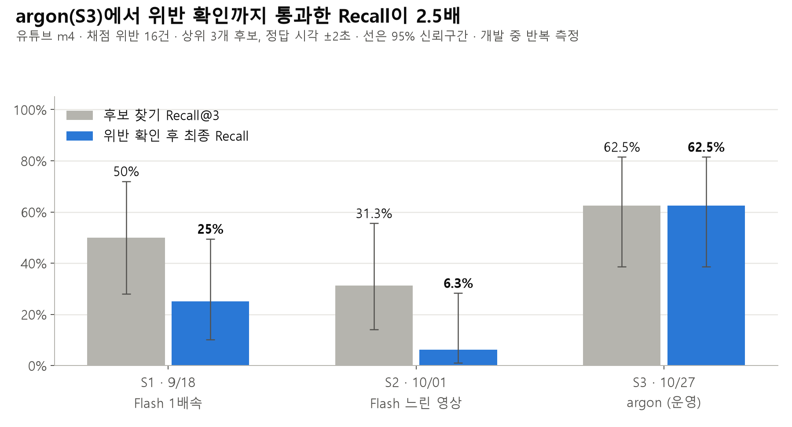
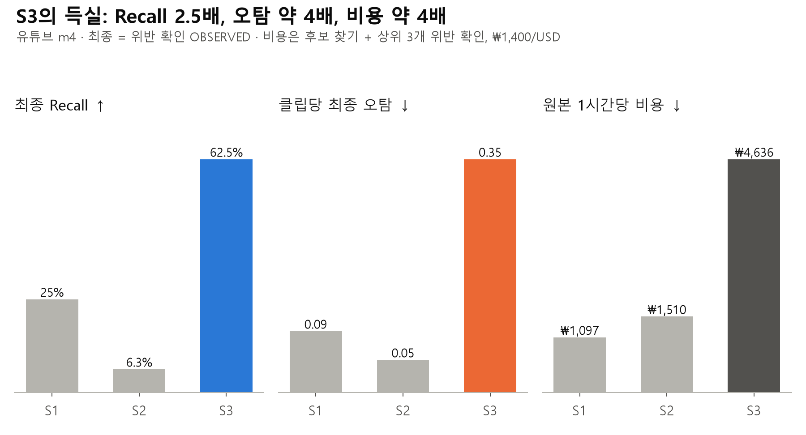
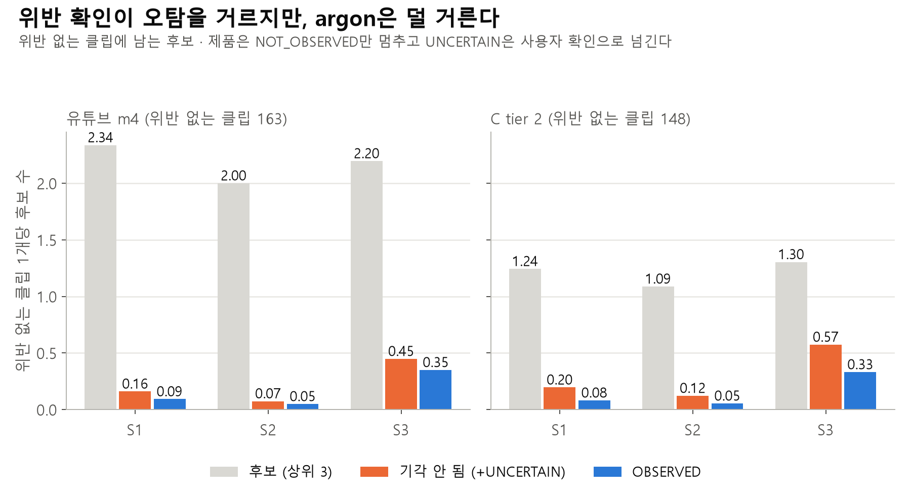
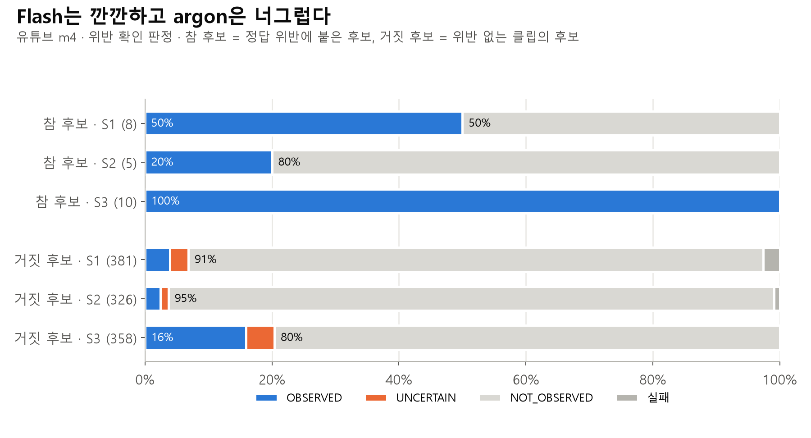

# 2026-10-28 · Search 시점별(S1·S2·S3) 전체 경로 평가 — 후보 찾기 → 위반 확인

작성: 김대원 · 브랜치 `feat/eval-search-points` · 실행 코드 `be362664`

운영 Search가 바뀐 세 시점을 보유 평가셋 3종에 같은 코드로 다시 돌려, 후보 찾기(Coarse)와 위반 확인(Fine)을 함께 쟀다. **개발 중 반복 측정**이다. 잠근 셋은 쓰지 않았고(`64924b51`), 수치는 발표·의사결정 참고용이지 일반화 성능 주장이 아니다.

시각화 페이지(비공개, 공유 전에는 본인만 열람): https://claude.ai/artifact/R4mdGHAEZV5dPD4ynxhQyT

## 한눈에 — 유튜브 m4 (179클립 · 2.96시간 · 채점 위반 16건 · 위반 없는 클립 163)

| 지표 | S1 · 9/18 Flash 1배속 | S2 · 10/01 Flash 느린 영상 | **S3 · 10/27 argon (운영)** |
| --- | --- | --- | --- |
| 후보 찾기 Recall@3 (95% CI) | 0.50 (0.28–0.72) | 0.31 (0.14–0.56) | **0.63** (0.39–0.82) |
| 최종 Recall — OBSERVED만 (95% CI) | 0.25 (0.10–0.49) · 4건 | 0.06 (0.01–0.28) · 1건 | **0.63** (0.39–0.82) · 10건 |
| 참 후보 확인율 (OBSERVED / 사건에 붙은 후보) | 0.50 (4/8) | 0.20 (1/5) | **1.00** (10/10) |
| 거짓 후보 기각율 (NOT_OBSERVED / 음성 클립 후보) | 0.91 | 0.95 | 0.80 |
| 위반 없는 클립당 후보(상위 3) | 2.34 | 2.00 | 2.20 |
| 위반 없는 클립당 최종 오탐 — OBSERVED | 0.09 (15건) | 0.05 (8건) | 0.35 (57건) |
| 위 + UNCERTAIN (사용자에게 가는 양) | 0.16 | 0.07 | 0.45 |
| 원본 1시간당 비용 | $0.78 ≈ ₩1,097 | $1.08 ≈ ₩1,510 | $3.31 ≈ ₩4,636 |
| 응답 중앙값 후보 찾기 / 위반 확인 | 8.0s / 8.1s | 9.0s / 7.9s | 13.6s / 11.8s |
| 후보 일부·전부를 잃은 클립 | 1 | **77** | 9 |

**한 줄:** argon으로 바꾼 S3는 후보 찾기와 위반 확인 양쪽이 좋아져, 위반 확인까지 통과한 최종 Recall이 S1의 2.5배다. 대가로 위반 없는 클립에서 OBSERVED로 남는 오탐이 약 4배, 비용이 약 4배, 응답이 약 1.5배 늘었다. S2는 Flash가 늘린 영상의 시각을 자주 잘못 답해 세 시점 중 가장 낮다.

## 발표용 차트

이미지 원본은 `img/`에 있다. 수치는 이 문서의 표와 같다.









## [CASE]

| 셋 | manifest · GT | 클립 · 길이 | 채점 위반 | 위반 없는 클립 | 쓰임 |
| --- | --- | --- | --- | --- | --- |
| 유튜브 m4 | `b_youtube_m4` m4 · g4 | 179 · 2.96h | 16 (실선 차로변경 11 · 신호 3 · 중앙선 2; `YT_0001_C47` 경계 제외) | 163 | Recall·오탐 비교의 주 셋 |
| C tier 2 | `ctier2` · g1 | 149 · 2.51h | 1 (중앙선) | 148 | 오탐 비교 |
| C tier 3 | `ctier3` · g1 | 8 · 0.25h | 3 (실선 2 · 중앙선 1) | 6 | 참고 |

**해석 주의:** 유튜브 m4도 위반 1건 = 6.25%p다. 세 시점의 Recall 신뢰구간은 서로 겹친다. C tier 2·3은 위반이 1·3건이라 Recall을 비교하지 않는다.

## [INPUT]

- user hint 없음, 대상 차량 힌트 없음
- 탐색 유형: `VisualEventType` 전부, 클립 전체 구간

## [PIPELINE]

`eval/runners/impls/search_pipeline.py` (`search:s1-flash-1x` · `search:s2-flash-slow` · `search:s3-argon-gore`). 지금 search 코드 위에서 시점 사이에 바뀐 설정만 갈아 끼운다. search 모듈 코드는 고치지 않았다.

| 시점 | 모델 | 후보 찾기 / 위반 확인 원본 fps (배속) | 위반 확인 분기부 문장 | 단가 (1M 토큰, 입력/출력) |
| --- | --- | --- | --- | --- |
| S1 | `gemini-3.8-flash` | 1 / 1 (1x) | 없음 | $0.815 / $4.078 |
| S2 | `gemini-3.8-flash` | 2 / 4 (0.5x / 0.25x) | 없음 | 같음 |
| S3 | `gemini-4-argon` | 2 / 4 | `fine-gore-v1` | $2.025 / $10.125 |

- 위반 확인은 클립마다 점수 상위 3개 후보에만 돌린다. 사용자가 고른 후보에만 도는 제품 흐름을 Recall@3과 같은 범위로 근사했다.
- 채점: 후보 찾기는 `candidate` s5(허용 ±2.0s), 전체 경로는 `pipeline` pl1. 최종 결과는 위반 확인을 통과한 후보만 남겨 다시 사건에 배정한다. 통과 기준은 OBSERVED만(`observed`)과 NOT_OBSERVED가 아닌 것(`not_rejected`, 제품이 UNCERTAIN을 사용자 확인으로 넘기므로) 두 가지다.
- 동시 호출 4, 각 1회 실행.

**재구성의 한계:** S1·S2는 당시 코드 그대로가 아니다. 이후 들어간 실패 처리(영상 밖 후보만 버리는 PARTIAL 처리 등)와 검증 코드는 지금 것을 쓴다. S1의 위반 확인은 당시 2 fps·720p로 보냈지만 프록시가 1 fps로 처리했으므로(gemini-proxy-video-sampling-2026-09-28) 1 fps로 뒀다.

## [RESULT]

### 사건별 — 유튜브 m4 (상위 3개 후보, 허용 2.0s)

「확인」은 위반 확인에서 OBSERVED를 받은 적중, 「후보만」은 후보 찾기에서는 맞혔으나 위반 확인에서 OBSERVED를 못 받은 사건이다.

| 클립 | 유형 | S1 | S2 | S3 |
| --- | --- | --- | --- | --- |
| YT_0001_C08 | 신호 | 후보만 | 후보만 | 확인 |
| YT_0001_C09 | 실선 | - | 후보만 | 확인 |
| YT_0001_C33 | 신호 | 후보만 | - | 확인 |
| YT_0001_C39 | 실선 | - | - | - |
| YT_0002_C00 | 중앙선 | 확인 | - | 확인 |
| YT_0003_C05 | 실선 | - | - | - |
| YT_0003_C10 | 실선 | 확인 | 후보만 | 확인 |
| YT_0003_C28 | 중앙선 | - | - | - |
| YT_0003_C38 | 실선 | 확인 | 확인 | 확인 |
| YT_0003_C39 | 실선 | 후보만 | 후보만 | 확인 |
| YT_0003_C44 | 실선 | - | - | - |
| YT_0004_C18 | 신호 | - | - | 확인 |
| YT_0004_C40 | 실선 | 확인 | - | 확인 |
| YT_0004_C43 | 실선 | - | - | 확인 |
| YT_0004_C44 | 실선 | 후보만 | - | - |

한 클립에 같은 유형 사건이 2건 있어 행은 15개다(합계 16건). S1이 확인까지 맞힌 사건은 S3도 모두 맞혔다. 네 건(`YT_0001_C39`, `YT_0003_C05`·`C28`·`C44`)은 세 시점 모두 놓쳤다.

### 유형별 후보 찾기 Recall@3 — 유튜브 m4

| 유형 (건) | S1 | S2 | S3 |
| --- | --- | --- | --- |
| 실선 차로변경 (11) | 0.45 | 0.36 | 0.55 |
| 신호 (3) | 0.67 | 0.33 | 1.00 |
| 중앙선 (2) | 0.50 | 0.00 | 0.50 |

### 위반 확인 판정 분포 — 유튜브 m4 (상위 3개 후보)

| | S1 | S2 | S3 |
| --- | --- | --- | --- |
| 참 후보 OBSERVED / UNCERTAIN / NOT_OBSERVED / 실패 | 4 / 0 / 4 / 0 | 1 / 0 / 4 / 0 | 10 / 0 / 0 / 0 |
| 거짓 후보 OBSERVED / UNCERTAIN / NOT_OBSERVED / 실패 | 15 / 11 / 345 / 10 | 8 / 4 / 311 / 3 | 57 / 16 / 285 / 0 |

Flash(S1·S2)의 위반 확인은 거짓 후보를 잘 거르지만 참 후보도 절반 이상 기각한다. argon(S3)은 참 후보를 모두 확인하는 대신 거짓 후보의 약 16%를 OBSERVED로 통과시킨다. 위반 확인이 「깐깐한 Flash」에서 「너그러운 argon」으로 바뀌었다.

### 오탐 — 위반 없는 클립

| 셋 | 지표 | S1 | S2 | S3 |
| --- | --- | --- | --- | --- |
| 유튜브 m4 (163) | 최종 오탐 OBSERVED · 오탐 있는 클립 | 15 · 15 | 8 · 8 | 57 · 44 |
| C tier 2 (148) | 최종 오탐 OBSERVED · 오탐 있는 클립 | 12 · 10 | 8 · 8 | 49 · 38 |
| C tier 2 (148) | 거짓 후보 기각율 | 0.83 | 0.86 | 0.56 |
| C tier 3 (6) | 최종 오탐 OBSERVED | 1 | 2 | 2 |

C tier 2에서 argon의 기각율이 특히 낮다(0.56). S3를 쓰면 사용자가 위반 없는 클립 4개 중 약 1개에서 OBSERVED 후보를 보게 된다.

### C tier 2·3 Recall (참고)

C tier 2의 중앙선 1건은 S3만 후보 찾기·위반 확인 모두 맞혔다. C tier 3 위반 3건 중 S3가 1건(실선)을 확인까지 맞혔고 S1·S2는 0건이다.

## [FAILURE]

| 실행 | 후보 일부·전부를 잃은 클립 | 원인 | 위반 확인 오류 |
| --- | --- | --- | --- |
| S1 유튜브 m4 | 1 (FAILED) | `PROVIDER_RESPONSE_INVALID` | 12 `ProviderPayloadError` |
| S2 유튜브 m4 | 77 (PARTIAL 64 · FAILED 13) | `COARSE_SPAN_OUT_OF_SOURCE` 75 · 응답 형식 2 | 4 |
| S2 C tier 2 | 35 (PARTIAL 23 · FAILED 12) | `COARSE_SPAN_OUT_OF_SOURCE` | 4 |
| S3 유튜브 m4 · C tier 2 | 9 · 3 (PARTIAL) | `COARSE_SPAN_OUT_OF_SOURCE` | 0 |

**S2의 영상 밖 후보:** Flash가 늘린 영상 기준 시각을 자주 넘겨 답했다(유튜브 m4 179클립 중 75클립, 42%). 남은 후보도 클립 앞 30초에 78%가 몰렸다(S1 60%, S3 53%). 원본 시각으로 답한 응답을 배속만큼 줄인 것으로 보인다. 10/01 시험(search-v3-production-verify, 21호출)에서는 1건뿐이던 현상이 179클립에서는 흔했다. 따라서 S2의 하락은 「느린 영상이 나쁘다」가 아니라 「Flash가 늘린 시간축을 안정적으로 따르지 못한다」로 읽는다. 같은 배속의 argon(S3)은 영상 밖 후보가 9클립뿐이다.

## 비용 산정

usage ledger의 토큰 수 × 위 단가, ₩1,400/USD. 9회 실행 합계 $25.56 ≈ ₩35,800(사전 추정 $19보다 많다. 주로 S3 유튜브 m4 위반 확인이 $5.71). 위반 확인이 비용의 절반 남짓(58–61%)이다.

| 셋 | S1 | S2 | S3 |
| --- | --- | --- | --- |
| 유튜브 m4 | $2.32 | $3.19 | $9.81 |
| C tier 2 | $1.26 | $1.94 | $6.17 |
| C tier 3 | $0.11 | $0.17 | $0.59 |

## 재현

```bash
for p in s1-flash-1x s2-flash-slow s3-argon-gore; do
  for m in b_youtube_m4 ctier2 ctier3; do
    id="search_${p//-/_}_${m}_20261028"
    python -m eval.run --impl search:$p --manifest $m --stage candidate --run-id $id
    python -m eval.score --prediction $id
  done
done
```

결과 원본: `eval/predictions/search_s{1,2,3}_*_20261028.json` · `eval/results/search_s{1,2,3}_*_20261028.*.s5-c3.json`

## [LEARNING]

1. **모델 교체(S3)가 Recall을 올린 주 요인이다.** 후보 찾기 Recall@3 0.50→0.63, 위반 확인 확인율 0.50→1.00이 겹쳐 최종 Recall이 0.25→0.63이 됐다. 다만 n=16이라 신뢰구간이 겹친다.
2. **S3의 다음 과제는 오탐이다.** 위반 확인이 거짓 후보를 덜 거른다(유튜브 0.91→0.80, C tier 2 0.83→0.56). 분기부 문장과 argon 중 무엇 때문인지는 이 실험으로 가를 수 없다. 「argon + 분기부 문장 없음」을 한 번 더 돌리면 가를 수 있다.
3. **늘린 영상은 모델에 따라 다르게 작동한다.** Flash에는 해로웠고 argon에서는 영상 밖 후보가 드물다. S3의 배속 효과만 따로 재려면 「argon 1배속」이 필요하다.
4. **비용·지연은 S3가 S1의 약 4배·1.5배다.** 원본 1시간당 ₩4,600 수준이다.
5. 1회 실행값이다. 같은 설정을 다시 돌리면 몇 건씩 바뀔 수 있다(반복 일관성은 eval.repeat에서 별도로 잰다).
